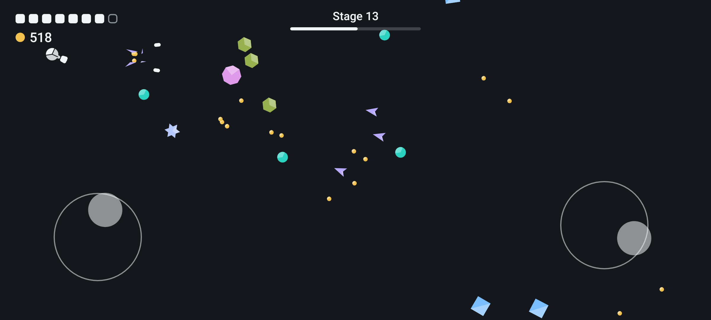
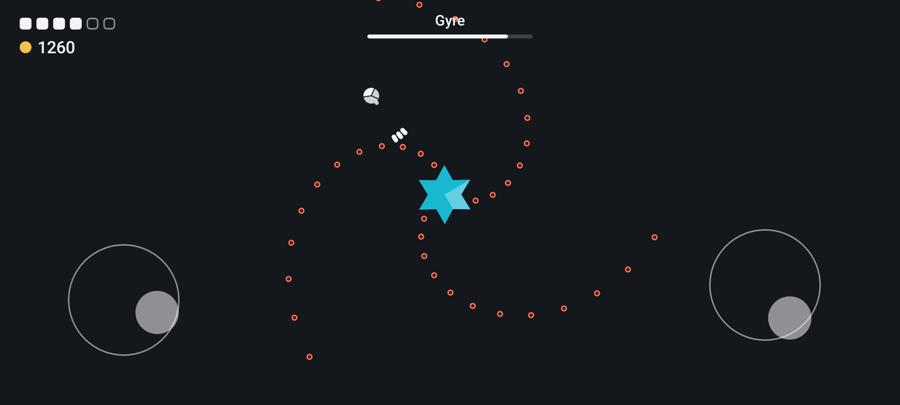
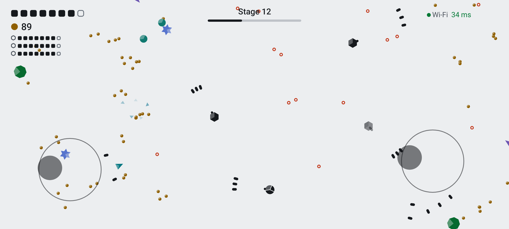
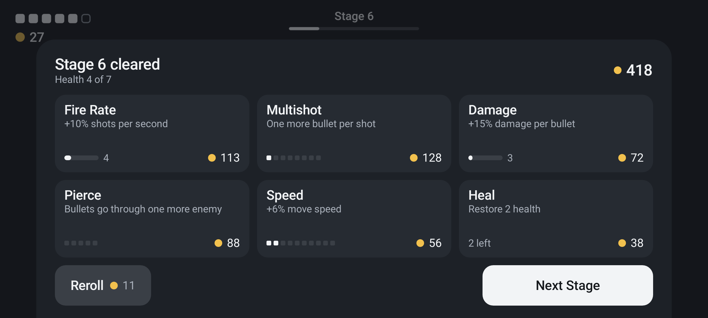

# Tessel

A landscape twin-stick shooter for Android. Left thumb moves, right thumb aims and fires. Geometric enemies pour in from the edges, break into pieces when you hit them hard enough, and drop coins you spend between stages. Every fifth stage ends in a boss. Up to eight friends can play on one team, each on their own phone, with no internet and no account.



## How a run goes

Each stage lasts a minute. When it ends you get a few seconds to clear what is left, then the shop opens. You can buy the same upgrade as many times as your coins allow, but every level costs more than the one before, and everything costs more the further you get, because coins are worth more too.

New kinds of enemy keep turning up as the stages go by: ones that keep their distance and shoot, ones that aim a line and charge down it, ones that split in two or in four, turrets that park and spin. Each kind has its own colour and shape. Enemy shots are always hollow orange rings, and anything that is about to fire or charge warns you first.

Stage 5 brings the first boss, and another follows every five stages. After the fourth the line starts over, with tougher versions.

There are four difficulties. Easy is for your first runs: slower and softer enemies, slower shots, ten health where Normal gives eight, more coins, and bosses with less than half their usual health. Normal is a fair fight. Hard and Impossible take all of that the other way.



## Playing together

One phone taps Host and gets a four-letter code. The others tap Join and pick that code from the list. If your phones have NFC, the host can simply hold each friend's phone back to back with theirs and it joins on its own (Tessel has to be open on the friend's phone).

The phones find each other and pair using Google's Nearby Connections, so they need Google Play services, and Bluetooth and Wi-Fi switched on. Wi-Fi does not have to be connected to a network. More players means more enemies, and bosses with more health.

Once a game starts, if the phones are on the same Wi-Fi network (at home, or one phone's hotspot), they stop going through Nearby and talk straight to each other over that network. That is several times quicker, because Nearby adds its own delay to every message. If the direct link drops, they carry on through Nearby and try the direct link again a few seconds later. Nothing leaves your network.

Each phone decides for itself what its own shots hit and what hits it, judged against exactly what it shows. The host goes along with that, so on a slow link you never lose a shot you landed or take a hit you dodged. Enemies you finish break the moment your shot lands, and coins you walk into are yours at once, without waiting for the host.

In a co-op game the top right corner shows how the phones are linked and the round trip between them, for example "Direct 12 ms". Direct means the phones talk straight over your Wi-Fi network; Wi-Fi, Bluetooth and Bluetooth LE mean the game goes through Nearby on that radio. Green is quick, amber is noticeable and red is slow; Bluetooth LE is always red, because it cannot keep up. If you do not see Direct, putting both phones on the same Wi-Fi network usually helps. Settings can hide the readout.

If a phone drops out, the game waits 20 seconds for it to come back. The host can also choose to play on without it.

## Controllers

A Bluetooth or USB controller works alongside the touch sticks. The left stick moves, the right stick aims and fires, the right trigger fires wherever you last aimed, and Start pauses. In the menus the d-pad moves a ring from button to button and A presses it.





## Install

Download the newest `tesselvX.Y.apk` from the [releases page](../../releases) and open it on your phone. Android will ask you to allow installs from your browser or file manager the first time. Tessel needs Android 8 or newer.

From version 0.3 on, Settings has an Updates section at the bottom. Check for Updates looks at this page and installs a newer version if there is one. That is the only time Tessel uses the internet. In co-op the phones also talk to each other over your local network, but never past it.

All phones in a game need the same version.

## Building it yourself

You need a JDK (17 or newer) and the Android SDK with platform 37.

```
./gradlew assembleDebug        # app/build/outputs/apk/debug, installs next to a release as "Tessel Dev"
./gradlew test                 # the game logic runs on the JVM, no phone needed
./gradlew distApk              # signed release in dist/, needs a keystore.properties
./gradlew shots                # redraws the pictures in docs/ with the game's own renderer
```

`keystore.properties` sits in the project root and is not part of the repo. It holds `storeFile`, `storePassword`, `keyAlias` and `keyPassword`. Without it, release builds are signed with the debug key.

## Known limits

Co-op has been played on two phones (a Galaxy A71 and an A13), and the in-app updater has updated both. Games with more than two phones, the direct link, the NFC tap and controllers have been tested in code but not yet on real hardware. There is no sound yet, only vibration. The pictures above were drawn on a computer by the game's own rendering code at the A71's resolution, not captured from a phone.
